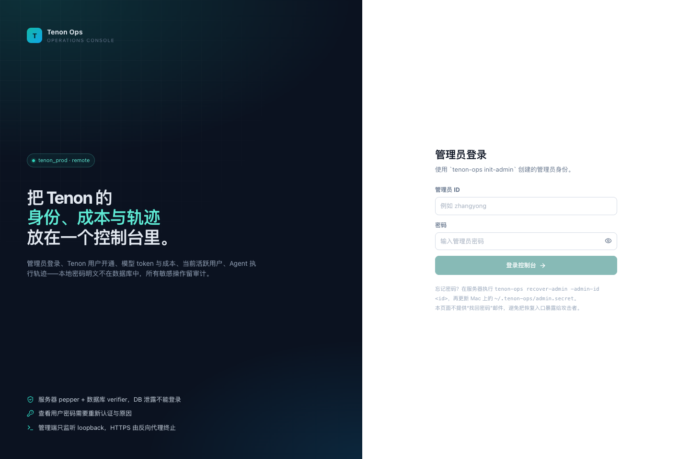
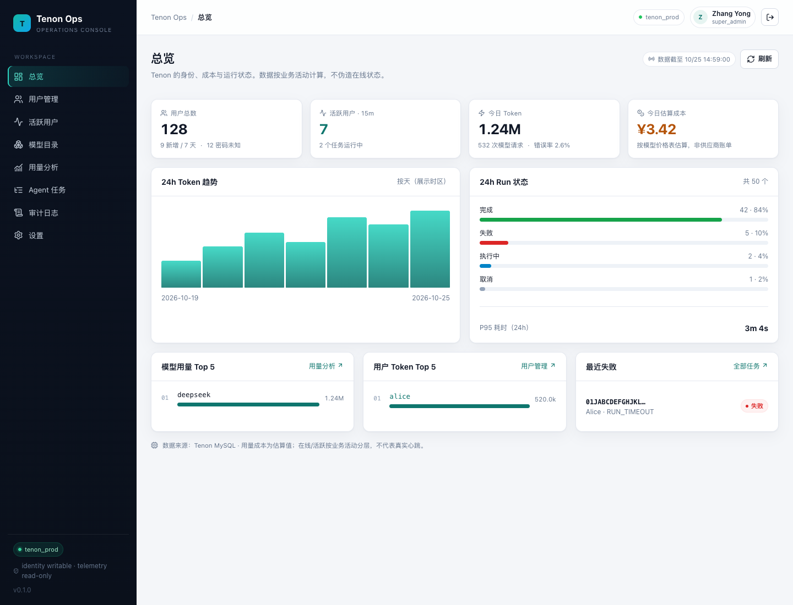
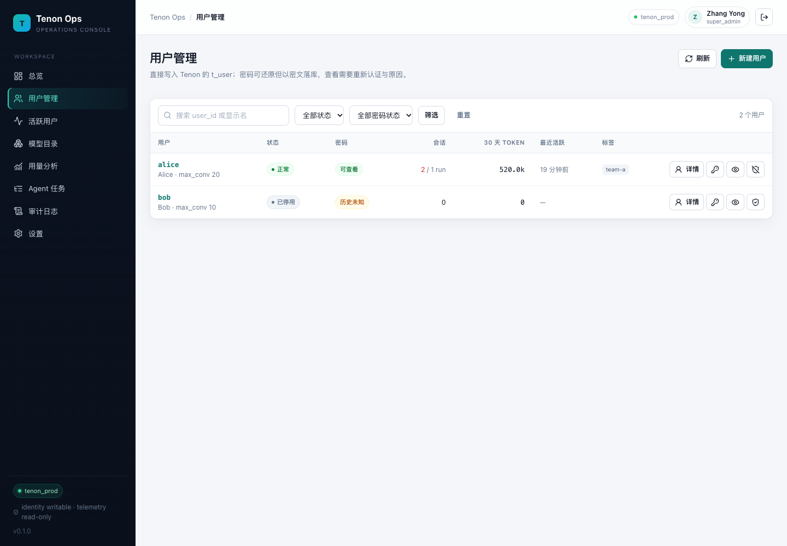

# Tenon Ops

> Repository: <https://github.com/0226zy/tenon_ops>  
> Status: P0 core implemented 2026-10-25. See “安全边界” and “已知限制” before exposing it.

Tenon 的远程运维控制台：管理员登录、Tenon 用户开通、模型/Token 用量、活跃用户、Agent 任务执行轨迹、审计日志。

技术栈与 Tenon 保持一致：

- **后端**：Go 1.25、`net/http`、MySQL 8、Argon2id、AES-256-GCM
- **前端**：Vue 3 + TypeScript + Pinia + Vue Router + Vite + lucide 图标
- **形态**：单二进制，Vue 构建产物通过 `go:embed` 内嵌
- **部署**：远程服务器 `127.0.0.1:7200`，nginx/Caddy 终止 TLS；不直接暴露 7200

> 当前版本是 **P0**：核心身份/用量/轨迹/审计闭环。  
> **没有实现 WebAuthn/TOTP MFA**。`exposure: public` 默认拒绝启动；请置于 VPN/固定 IP 白名单后，或显式设置 `allow_public_without_mfa: true` 接受风险（不推荐）。  
> 模型“就绪”状态固定为“未知”，因为管理端不读取 control 进程的环境变量；P1 再接控制层只读接口。

## 界面预览

以下截图使用 mock 数据，仅展示布局；真实数据来自 Tenon MySQL。

| 登录 | 总览 |
|---|---|
|  |  |

| 用户管理 |
|---|
|  |

## 功能

| 模块 | 已实现 |
|---|---|
| 管理员登录 | 服务器 `master.key` 派生 pepper；MySQL 只存 `Argon2id(HMAC(pepper, password))` verifier；签名会话 cookie + DB 吊销；登录限流/锁定；CSRF；step-up |
| Tenon 用户 | 列表/详情、创建、重置密码、停用/启用、查看密码、吊销会话、标签/备注、最大会话数；**事务直写 `t_user`**，Argon2id 与 Tenon 完全兼容 |
| 密码保管 | 可还原明文，AES-256-GCM 密文落库；密钥在服务器 `master.key`；查看需 step-up + reason + 审计 |
| 模型目录 | YAML 导入（严格字段）、元数据编辑、价格历史、24h 用量；不改 Tenon 路由 |
| 用量 | 按模型/用户/对话汇总，请求/token/错误率/估算成本、趋势、CSV 导出 |
| 活跃用户 | 运行中/在线/活跃/最近/今日/未活跃分层；明确按业务活动而非真实心跳 |
| Agent 任务 | Run 列表/详情、事件时间线、工具调用/结果、消息、用量、运行中 2 秒轮询跟随 |
| 审计 | 登录/写操作/查看密码/导出审计；追加写；CSV 导出；detail JSON |
| 系统 | 健康检查、schema 契约、密钥状态、数据新鲜度、设置 |
| CLI | `init-db` / `init-admin` / `recover-admin` / `doctor` / `backup-keys` / `serve` |

未实现（P1+）：WebAuthn/TOTP、多管理员/RBAC、Tenon 控制层 readiness/cancel 接口、批量导入、异步导出、价格重算、真实在线心跳。

## 架构

```text
Mac 浏览器 ──HTTPS──> nginx/Caddy ──> tenon-ops :7200（127.0.0.1）
                                      ├── tenon_admin（管理库）
                                      └── tenon_prod（只读 + t_user 身份写）
```

- 独立 schema `tenon_admin`，与 Tenon 同 MySQL 实例；创建用户跨 schema 单事务。
- 只写 Tenon 的 `t_user` / `t_auth_session`；对话、Run、事件、用量只读。
- `master.key` 只在服务器；`admin.secret` 只在 Mac；MySQL 永远不存管理员密码。

## 快速开始（本地）

要求：Go 1.25+、Node.js 20+、MySQL 8。Tenon 的 `t_user` / 运行表已存在。

```bash
# 1. 依赖与构建
make build        # npm ci + vite build + go build（bin/tenon-ops，内嵌前端）

# 2. 配置数据库连接（本机开发可用 SSH 隧道）
export TENON_OPS_DSN='tenon_ops_app:password@tcp(127.0.0.1:13306)/tenon_admin?parseTime=true&loc=UTC&charset=utf8mb4'

# 3. 建管理表（需要 CREATE 权限；也可由 DBA 执行 migrations/000001_init.mysql.sql）
bin/tenon-ops init-db -config deploy/config.local.yaml

# 4. 创建唯一管理员；密码打印一次，admin.secret 保存在 Mac
bin/tenon-ops init-admin -config deploy/config.local.yaml \
  -admin-id zhangyong --secret-dir ~/.tenon-ops

# 5. 启动
bin/tenon-ops serve -config deploy/config.local.yaml
# 打开 http://127.0.0.1:7200
```

前端热更新：

```bash
# 终端 A
bin/tenon-ops serve -config deploy/config.local.yaml
# 终端 B
cd web && npm run dev   # http://127.0.0.1:7201，/api 代理到 7200
```

> 本地 `config.local.yaml` 的 `allowed_origins` 同时包含 7200 和 7201；修改端口时同步修改，否则写请求会被 CSRF 拒绝。

## 数据库账号

`migrations/000001_init.mysql.sql` 末尾有完整授权模板。最小权限原则：

- `tenon_prod`：`SELECT` 全库；`t_user` 仅身份列的 `INSERT/UPDATE`；`t_auth_session` 仅 `Fexpire_time` 的 `UPDATE`
- `tenon_admin`：逐表授权；`tadm_audit_log` 只有 `SELECT/INSERT`
- 不授予 DDL；不授予 `t_user` 的 `DELETE`

MySQL 账号 host 必须匹配连接方式：Unix socket 用 `@'localhost'`，TCP `127.0.0.1` 用 `@'127.0.0.1'`；bootstrap 经 SSH 隧道时服务器侧看到 `127.0.0.1`。不要用 `@'%'` 图省事。

## 远程部署

完整步骤见 [docs/deployment.md](docs/deployment.md)。要点：

1. 服务器建 `tenon-ops` 系统用户、`/etc/tenon-ops`、`/etc/tenon-ops/keys`（0700）。
2. DBA 建 `tenon_admin` 和最小权限账号；执行 `init-db`。
3. **在 Mac 上**运行 `init-admin`，把 `master.key` 复制到服务器；`admin.secret` 留在 Mac。
4. 安装 systemd unit 与 nginx 配置；只监听 loopback，nginx 终止 TLS。
5. 防火墙只放行 22（管理 IP）、443（白名单/VPN）；**7200、3306 不对公网**。

```bash
# Mac 上（通过 SSH 隧道写 verifier）
ssh -N -L 13306:127.0.0.1:3306 root@<server>
./bin/tenon-ops init-admin -config deploy/config.example.yaml \
  -admin-id zhangyong --keys-dir ./tenon-ops-bootstrap/keys \
  --secret-dir ~/.tenon-ops

# 复制服务器密钥（仅 master.key）
scp ./tenon-ops-bootstrap/keys/master.key root@<server>:/etc/tenon-ops/keys/master.key
```

## 配置

| 键 | 说明 |
|---|---|
| `mode` | `remote`（默认）或 `local`；只影响默认 cookie/部署语义 |
| `exposure` | `private`（默认）或 `public`；`public` 必须有 MFA，未实现则拒绝启动 |
| `listen` | 默认 `127.0.0.1:7200`；非 loopback 需 `allow_remote_listen` |
| `public_url` | 浏览器访问的完整 URL；用于 Origin/Host 默认值 |
| `db.dsn_env` | 默认 `TENON_OPS_DSN`；DSN 包含密码，放 `env` 文件 |
| `db.admin_schema` / `db.tenon_schema` | 默认 `tenon_admin` / `tenon_prod` |
| `security.keys_dir` | `master.key` 所在目录，服务器 0700 |
| `security.cookie_secure` | HTTPS 下 true；本地 HTTP 开发 false |
| `security.allowed_origins` / `allowed_hosts` | 必须与浏览器地址/反代 Host 一致 |
| `security.trusted_proxies` | 只填 nginx 地址（同机为 127.0.0.1） |
| `security.require_step_up_writes` | 用户写操作是否强制 step-up（公网建议 true） |

## API

所有接口在 `/api/ops/v1` 下，cookie 会话 + `X-CSRF-Token`。详见 [docs/api.md](docs/api.md)。

主要端点：

```text
POST /auth/login                 POST /auth/logout
GET  /auth/me                    POST /auth/step-up
GET  /dashboard/summary
GET/POST /users                  GET/PATCH /users/{id}
POST /users/{id}/reset-password  POST /users/{id}/disable|enable
POST /users/{id}/reveal-password POST /users/{id}/sessions/revoke
GET  /models                     POST /models/import
PATCH /models/{id}               POST /models/{id}/prices
GET  /usage/overview             GET  /usage/export
GET  /presence
GET  /runs                       GET  /runs/{id}
GET  /runs/{id}/events           GET  /runs/{id}/messages
GET  /audit                      GET  /audit/export
GET  /system/health              GET/PATCH /system/settings
```

## 安全边界

- **只拿 MySQL dump**：不能登录（无服务器 pepper）；不能解密用户密码（无 `master.key`）。
- **拿到服务器 `master.key` + DB**：可离线攻击管理员密码、解密 Tenon 用户密码；服务器是信任边界。不要把 7200/3306 暴露公网。
- **管理员密码明文只在 Mac** 的 `admin.secret`；服务器不存。改密后需把 UI 一次性显示/下载的新文件保存到 Mac。
- 查看密码、导出审计/用量需要 step-up + 原因，并写审计。
- Redis/缓存未引入；所有状态在 MySQL。

详见 [docs/security.md](docs/security.md)。

## 目录

```text
cmd/tenon-ops/          CLI（serve/init-db/init-admin/doctor/recover-admin/backup-keys）
internal/api/           HTTP 路由、中间件、handlers
internal/auth/          管理员登录、会话、step-up、审计
internal/services/      用户/模型/用量/活跃/Run/审计/系统用例
internal/store/         MySQL SQL、事务、schema 初始化
internal/security/      Argon2id、AES-GCM、签名会话、密钥派生
internal/web/           内嵌 Vue 构建产物
web/                    Vue 3 + TS 前端源码
migrations/             tenon_admin DDL
deploy/                 systemd/nginx/config/env 模板
docs/                   部署、安全、API
```

## 测试

```bash
go test ./...
cd web && npm run build
```

前端类型检查：`cd web && npx vue-tsc --noEmit -p tsconfig.json`。

当前测试覆盖密码/pepper、AES-GCM AAD、签名会话/CSRF、密钥权限、SQL 拆分、活跃分层、CSV 安全等纯逻辑。**没有在本仓库内启动 MySQL 做 E2E**；部署前请按 `docs/deployment.md` 执行 `init-db`、登录、创建用户、真实 Tenon 登录的冒烟测试。

## 设计基线

产品/功能/流程设计见 [docs/design-baseline.md](docs/design-baseline.md)。实现与设计的差异：

- 未实现 WebAuthn/TOTP；`exposure: public` 默认拒绝。
- 模型 readiness 固定“未知”；未接 control 管理接口。
- 活跃用户按业务活动分层，不是心跳。
- 未实现 Run 取消（只读）；没有直接改 `t_run`。
- 未实现多管理员/RBAC；表结构已预留角色字段。
